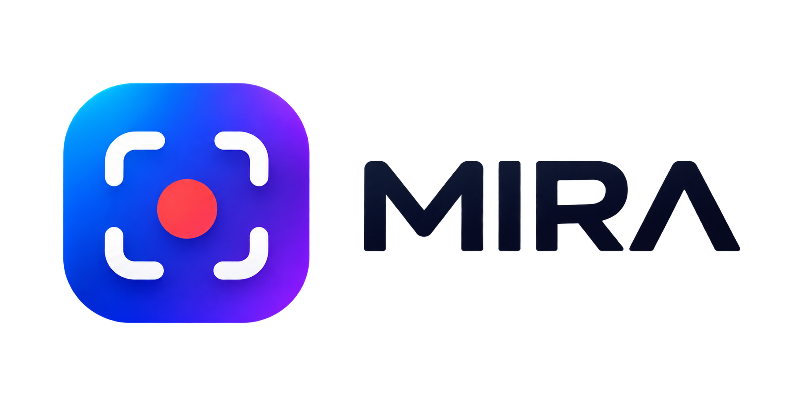

# Mira

<p align="center"></p>

App de capturas de pantalla y grabación de vídeo para Windows, con editor de anotaciones y editor de vídeo.
Diseño y código propios, inspirados en el flujo de la Herramienta Recortes (elegir **Foto / Vídeo / Texto** al capturar)
y en el editor de CleanShot X.

## Capturar

| Acción | Cómo |
| --- | --- |
| Capturar | `Ctrl + Mayús + S` (configurable) o clic en el icono de la bandeja |
| Elegir qué hacer | Barra superior: **Foto**, **Vídeo** o **Texto** |
| Modos de foto | Región, Ventana, Pantalla completa y **Desplazamiento** (página o chat entero) |
| Última región | Botón ↺ de la barra, menú de la bandeja o `Alt + Mayús + R` |
| Copiar texto (OCR) | Modo **Texto** o `Alt + Mayús + T`: selecciona una zona y su texto se copia |
| Retardo | 3 / 5 / 10 s (modo foto) |
| Cancelar | `Esc` o clic derecho |

Tras capturar aparece una **vista previa flotante** con Editar, Copiar, Guardar y **Anclar** (la captura queda flotando
encima de todo: rueda = tamaño, `Ctrl` + rueda = opacidad, doble clic = editar). Puedes arrastrarla a otra aplicación.
Se apilan hasta 4, muestran el tamaño y el peso al pasar el ratón, se cierran deslizando a un lado y la última cerrada
se recupera con `Ctrl+Z` o desde la bandeja. En Ajustes eliges su posición, tamaño y cierre automático.

**Historial:** desde la bandeja («Historial de capturas…») ves todo lo capturado, grabado o copiado como texto en los
últimos 30 días, con filtros, búsqueda en el texto reconocido y acciones (abrir, copiar, guardar, anclar, borrar).

**Códigos QR:** el modo Texto también los lee; copia su contenido y, si es un enlace, ofrece abrirlo.

**Captura con desplazamiento:** selecciona la zona que se desplaza; la página baja sola y las partes se unen (detecta
cabeceras fijas y quita la barra de desplazamiento). Puedes pausar el modo automático y desplazarte tú con la rueda.

## Editor de imágenes

Las herramientas parecidas están agrupadas: el botón recuerda la última usada y la flechita ▾ muestra el resto.

| Grupo | Herramientas (atajo) |
| --- | --- |
| — | Seleccionar `V` · Flecha `A` · Texto `T` · Contador `N` · Goma `G` · Quitar objeto `Q` · Recortar `C` (proporciones fijas y ajuste a bordes; `Alt` lo suelta) |
| Formas | Rectángulo `R` · Elipse `O` · Línea `L` (borde, relleno o ambos) |
| Dibujo | Lápiz `P` · Resaltador `H` |
| Ocultar | Pixelar `X` · Desenfocar `B` · **Censura automática** (correos, teléfonos, tarjetas, IBAN, DNI/NIE, IP) |
| Destacar | **Foco** `F` (oscurece el resto) · **Lupa** `M` (×1,5 / ×2 / ×3) |

- **Flechas y líneas curvables:** tiradores en los extremos y uno central para curvarlas; 4 estilos (normal, fina, gruesa, doble).
- **Texto:** 7 estilos (simple, contorno, sombra, fondo, translúcido, bocadillo y píldora).
- **Resaltador inteligente:** sobre texto se ajusta solo a la altura de la línea. **Lápiz** con suavizado automático.
- **Desenfoque seguro:** destruye el detalle antes de desenfocar, no se puede revertir en la imagen exportada.
- **Menú Imagen:** rotar, voltear, **redimensionar**, censura automática, copiar el texto de la imagen y anclar.
- **Quitar objeto:** rellena con la textura de alrededor o con un color plano.
- **Fondo decorativo:** 20 fondos o una imagen propia, proporción (1:1, 4:3, 16:9, 9:16), alineación, margen, esquinas,
  sombra, **Auto Balance** (quita los bordes de un solo color para que el espacio quede igual) y favoritos.
- Zoom con `Ctrl` + rueda o la barra de abajo · Deshacer `Ctrl+Z` / rehacer `Ctrl+Y`.

## Vídeo

- Opciones al grabar: micrófono, audio del sistema, **mostrar clics**, **mostrar teclas** (desactivado por defecto,
  para no grabar contraseñas sin querer) y **webcam en burbuja** (se puede mover y cambiar de tamaño S/M/L).
- **Editor de vídeo** (doble clic en la miniatura o «Editar y recortar»): recorta el inicio y el final arrastrando los
  tiradores amarillos (o con `I` / `O`) y exporta a **MP4, GIF o WebM** eligiendo resolución, FPS y calidad.

## Ajustes

Carpeta de guardado, formato PNG/JPG, copiar o guardar automáticamente, iniciar con Windows y los tres atajos
(capturar, repetir última región y copiar texto).

## Cómo está construida

Mira es una aplicación de escritorio hecha con tecnología web (HTML, CSS y TypeScript) dentro de **Electron**. Funciona
como dos «mitades» que hablan entre sí:

```
┌───────────────────────────── Mira ────────────────────────────┐
│  Proceso principal (src/main)          Ventanas (src/renderer)│
│  · bandeja y atajos globales    ◄────►  · overlay de captura  │
│  · captura de pantalla           IPC    · editor de imágenes  │
│  · guardar, portapapeles, OCR           · editor de vídeo     │
│  · ffmpeg, API de Windows               · historial, ajustes… │
└───────────────────────────────────────────────────────────────┘
```

- **Proceso principal** (`src/main`): es el «motor». No tiene interfaz; vive en la bandeja, escucha los atajos de
  teclado, hace las capturas, guarda los archivos y habla con Windows.
- **Ventanas** (`src/renderer`): cada pantalla de la app (la barra de captura, el editor, el historial…) es una página
  web independiente con su propio HTML y TypeScript.
- **Puente seguro** (`src/preload`): las ventanas no acceden directamente al sistema. Piden cosas al proceso principal
  por mensajes con nombre (`editor:save`, `settings:get`…) y solo se permiten los canales de una lista blanca. Todos los
  canales están declarados con sus tipos en `src/shared/ipc.ts`, y las imágenes viajan como bytes, no como texto.

### Tecnologías y para qué sirve cada una

| Tecnología | Para qué la usa Mira |
| --- | --- |
| **Electron** | Convierte la app web en un programa de Windows: ventanas, bandeja del sistema, atajos globales, portapapeles y captura de pantalla |
| **TypeScript** | El lenguaje de todo el código: JavaScript con tipos, para detectar errores antes de ejecutar |
| **Vite + electron-vite** | Compila y empaqueta el código; en desarrollo recarga los cambios al momento (`npm run dev`) |
| **Konva** | Dibuja sobre la captura en el editor: flechas, formas, textos, selección y transformación de elementos |
| **koffi** | Llama a funciones nativas de Windows (`user32`, `dwmapi`): listar ventanas, mover el ratón, simular la rueda y leer teclas y clics |
| **Windows.Media.Ocr** | El reconocimiento de texto propio de Windows, sin internet, ejecutado mediante un proceso de PowerShell |
| **jsQR** | Lee códigos QR dentro de una captura |
| **ffmpeg** (`ffmpeg-static`) | Procesa los vídeos: recortar y exportar a MP4, GIF o WebM |
| **Vitest** | Tests unitarios de la lógica que no depende de la pantalla (`npm test`) |
| **electron-builder** | Genera el instalador `.exe` para Windows (`npm run dist`) |

Todo se procesa en el propio ordenador: Mira no envía capturas ni textos a ningún servidor.

### Estructura de carpetas

| Carpeta | Contenido |
| --- | --- |
| `src/main/` | Proceso principal: captura, grabación, OCR, historial, ajustes, API de Windows |
| `src/renderer/` | Una página por ventana (`editor.html` + `editor/main.ts`, etc.) y estilos e iconos compartidos |
| `src/preload/` | Puente seguro entre ventanas y proceso principal |
| `src/shared/` | Tipos de datos comunes a las dos mitades |
| `resources/` | Icono, logo y el script de OCR (`ocr.ps1`) |
| `tests/` | Tests unitarios (Vitest) |
| `docs/` | Documentación de producto con capturas |

## Desarrollo

```bash
npm install
npm run dev        # app en modo desarrollo
npm run typecheck  # comprobación de tipos
npm test           # tests unitarios (Vitest)
npm run dist       # instalador en dist/
```

## Documentación

La guía completa (funciones, guía de uso, atajos, ajustes, flujos de trabajo, solución de problemas y roadmap) está en
[docs/MIRA-Product-Documentation.md](docs/MIRA-Product-Documentation.md).

Cómo está hecho el código (arquitectura, tecnologías, especificaciones por funcionalidad, criterios de aceptación y
pruebas) está en [docs/MIRA-Guia-Tecnica.md](docs/MIRA-Guia-Tecnica.md).
