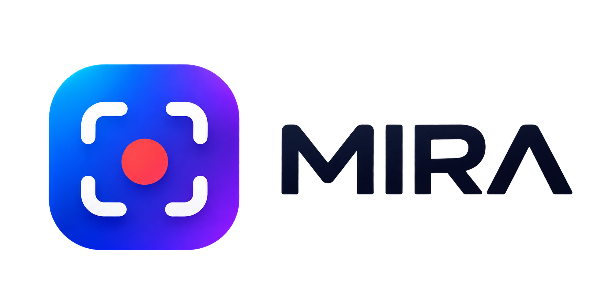
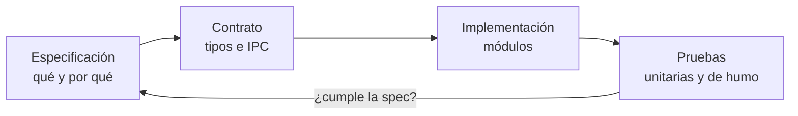
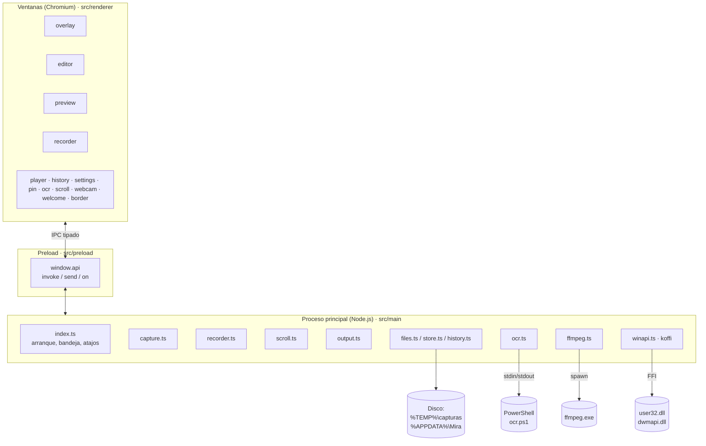
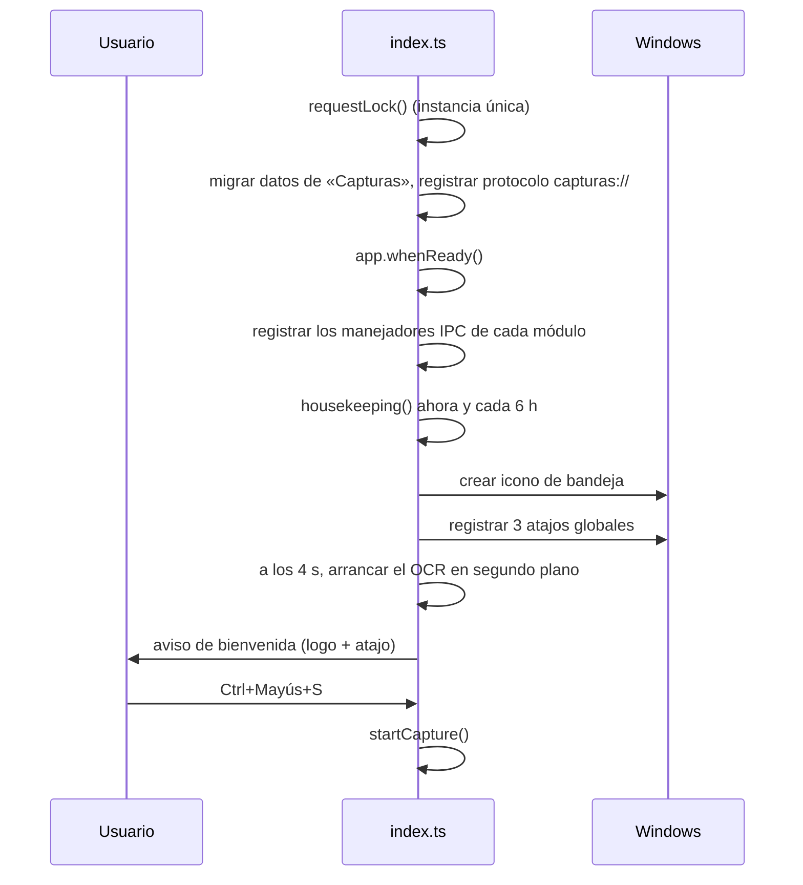
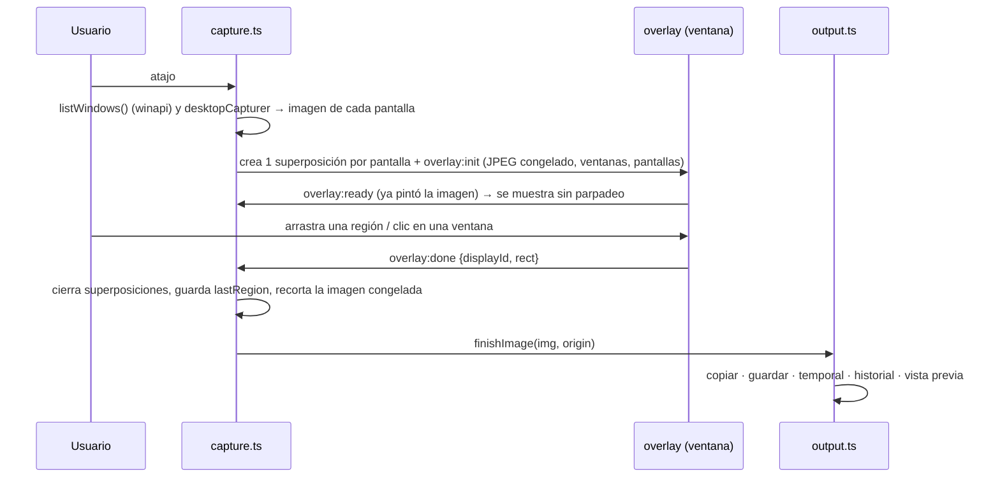
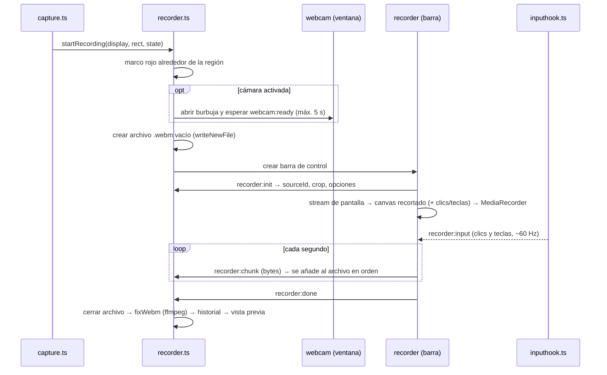
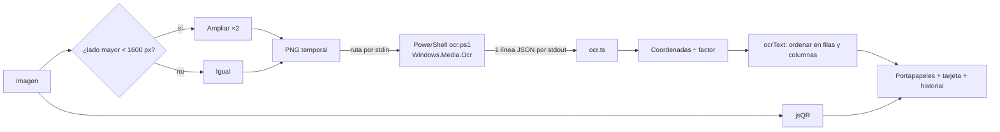
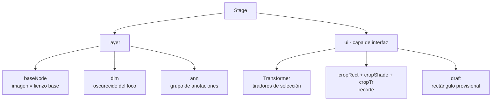

# MIRA – Guía técnica del código

<p align="center"></p>

> **Para quién es este documento.** Para alguien que empieza en el desarrollo guiado por especificaciones
> (*spec-driven development*) y necesita entender **qué hace el código de MIRA, cómo está organizado y por qué**.
> No hace falta saber Electron: cada concepto se explica la primera vez que aparece.
>
> **Qué no es.** No es el manual de usuario (eso está en [MIRA-Product-Documentation.md](MIRA-Product-Documentation.md))
> ni la guía rápida para trabajar en el repositorio (eso está en [CLAUDE.md](../CLAUDE.md)).

Versión 0.1.0 · noviembre de 2026 · **Verificado contra el código del commit `b2a0d43`.** Si el código ha cambiado
después de ese commit (`git log b2a0d43..HEAD -- src`), revisa las secciones afectadas antes de fiarte de ellas.

## Índice

1. [MIRA en una página](#1-mira-en-una-página)
2. [Cómo leer este documento (spec-driven)](#2-cómo-leer-este-documento-spec-driven)
3. [Glosario](#3-glosario)
4. [Tecnologías y por qué se eligieron](#4-tecnologías-y-por-qué-se-eligieron)
5. [Arquitectura general](#5-arquitectura-general)
6. [Estructura de carpetas](#6-estructura-de-carpetas)
7. [El contrato entre procesos: IPC tipado](#7-el-contrato-entre-procesos-ipc-tipado)
8. [Modelo de datos](#8-modelo-de-datos)
9. [Especificaciones por funcionalidad](#9-especificaciones-por-funcionalidad)
10. [El editor de imágenes por dentro](#10-el-editor-de-imágenes-por-dentro)
11. [Requisitos no funcionales](#11-requisitos-no-funcionales)
12. [Pruebas](#12-pruebas)
13. [Compilar, ejecutar y distribuir](#13-compilar-ejecutar-y-distribuir)
14. [Cómo añadir una funcionalidad nueva paso a paso](#14-cómo-añadir-una-funcionalidad-nueva-paso-a-paso)
15. [Trampas conocidas](#15-trampas-conocidas)
16. [Chuleta para explicar MIRA en 2 minutos](#16-chuleta-para-explicar-mira-en-2-minutos)

---

## 1. MIRA en una página

**MIRA** es una aplicación de escritorio para **Windows** que vive en la **bandeja del sistema** (los iconos junto al
reloj). Con un atajo de teclado (`Ctrl + Mayús + S`) congela la pantalla y deja elegir qué hacer:

| Modo | Qué produce | Dónde acaba |
| --- | --- | --- |
| **Foto** | Una imagen PNG de una región, una ventana, una pantalla o una página entera (con desplazamiento) | Vista previa flotante → editor, portapapeles, carpeta, historial |
| **Vídeo** | Una grabación WebM de una región o pantalla, con audio, clics, teclas y webcam opcionales | Vista previa → editor de vídeo → MP4 / GIF / WebM |
| **Texto** | El texto reconocido (OCR) o el contenido de un código QR | Portapapeles + tarjeta flotante |

Además tiene:

- **Editor de imágenes** con flechas, formas, textos, contadores, pixelado, desenfoque, foco, lupa, recorte, «quitar
  objeto», censura automática de datos sensibles, fondos decorativos…
- **Editor de vídeo** para recortar y exportar.
- **Historial** de los últimos 30 días.
- **Capturas ancladas**: una imagen que flota encima de todas las ventanas.

Todo se procesa **en local**: no hay servidor, ni cuentas, ni llamadas a internet. Hasta el OCR usa el motor que trae
Windows.

---

## 2. Cómo leer este documento (spec-driven)

En el desarrollo guiado por especificaciones, **antes de escribir código se escribe qué debe hacer** (la *spec*), y el
código y las pruebas se comprueban contra ella. Este documento sigue ese orden:



- La **especificación** de cada funcionalidad está en la [sección 9](#9-especificaciones-por-funcionalidad), con el
  mismo formato siempre: *Objetivo · Entradas · Salidas · Reglas · Criterios de aceptación · Dónde está el código*.
- El **contrato** son los tipos de TypeScript compartidos (`src/shared/types.ts`) y el mapa de canales IPC
  (`src/shared/ipc.ts`). Son la «frontera» que el compilador vigila: si un lado cambia y el otro no, no compila.
- La **implementación** está en `src/main` (proceso principal) y `src/renderer` (ventanas).
- Las **pruebas** están en `tests/` (Vitest) y en las pruebas de humo dentro de la app.
- La **trazabilidad** une las dos puntas: cada criterio de aceptación tiene un identificador (`CAP-01`, `REC-03`…) y
  dice cómo se verifica. El resumen de qué está cubierto por tests está en la
  [sección 12.3](#123-trazabilidad-criterios--pruebas).

> **Aviso honesto: estas specs se escribieron después del código.** MIRA no nació con especificaciones; las de la
> sección 9 describen lo que el código ya hace (*specs as-built*) y sirven de punto de partida. A partir de ahora el
> orden es el del diagrama: primero se escribe o se actualiza la spec, luego el código. La
> [sección 14](#14-cómo-añadir-una-funcionalidad-nueva-paso-a-paso) explica cómo.

> **Idea clave para un junior:** en MIRA el contrato no es un documento aparte que se queda desactualizado: es
> **código TypeScript**. Cambiar la spec de un mensaje entre ventanas = cambiar su tipo en `ipc.ts`, y el compilador te
> señala todos los sitios que tienes que actualizar.

---

## 3. Glosario

| Término | Significado en MIRA |
| --- | --- |
| **Proceso principal** (*main*) | El programa Node.js que arranca Electron. No tiene interfaz; crea ventanas, guarda archivos, habla con Windows. Código en `src/main/`. |
| **Renderer** (proceso de ventana) | Cada ventana es una página web (HTML + TypeScript) aislada en su propio proceso de Chromium. Código en `src/renderer/`. |
| **Preload** | Pequeño script que se ejecuta antes de cada página y le da un puente seguro (`window.api`) hacia el proceso principal. `src/preload/index.ts`. |
| **IPC** | *Inter-Process Communication*: los mensajes entre una ventana y el proceso principal. |
| **Canal** | El nombre de un mensaje IPC, por ejemplo `editor:save`. Siempre `prefijo:accion`. |
| **Superposición** (*overlay*) | La ventana a pantalla completa, sin bordes, que muestra la captura congelada para elegir la región. Una por monitor. |
| **Vista previa** (*preview*) | La tarjeta flotante que aparece en una esquina tras capturar. Se apilan hasta 4. |
| **Anclada** (*pin*) | Captura en una ventana siempre encima de las demás. |
| **DIP** | *Device Independent Pixels*: píxeles «lógicos». Con el zoom de Windows al 150 %, 100 DIP = 150 píxeles físicos. MIRA convierte entre ambos constantemente. |
| **Lienzo base** | En el editor, el `canvas` con la imagen de la captura (sin anotaciones). Es **inmutable**. |
| **Anotación** | Cualquier cosa dibujada encima (flecha, texto, rectángulo…). Es un nodo de Konva dentro del grupo `ann`. |
| **OCR** | Reconocimiento óptico de caracteres: leer el texto que hay en una imagen. |
| **ffmpeg** | Programa externo para convertir y recortar vídeo. MIRA lo trae empaquetado. |
| **Temporales** | Archivos en `%TEMP%\capturas`: capturas recién hechas, grabaciones en curso, imágenes para el OCR. Se borran a las 24 h. |
| **`userData`** | Carpeta de datos de la app (`%APPDATA%\Mira`): ajustes, historial, registro de errores. |

---

## 4. Tecnologías y por qué se eligieron

### 4.1 Tabla resumen

| Tecnología | Versión | Para qué se usa | Por qué |
| --- | --- | --- | --- |
| **Electron** | 45 | Base de la app de escritorio: ventanas, bandeja, atajos globales, captura de pantalla, portapapeles | Permite hacer la interfaz con HTML/CSS/TS y tiene APIs nativas para capturar la pantalla (`desktopCapturer`) y grabarla |
| **TypeScript** | 7 | Todo el código | Tipos estrictos (`strict: true`) para que el contrato entre procesos lo compruebe el compilador |
| **electron-vite** (+ **Vite** 8) | 6 | Compilar el proceso principal, el preload y las 13 páginas | Un solo comando compila los tres «mundos» y da recarga en caliente en desarrollo |
| **Konva** | 10 | Lienzo del editor de imágenes | Gestiona objetos dibujables (mover, seleccionar, redimensionar, clonar para deshacer) sobre `<canvas>` |
| **koffi** | 3 | Llamar a funciones de Windows (`user32.dll`, `dwmapi.dll`) desde Node | Sin compilar C++: enumerar ventanas, mover el cursor, girar la rueda, leer el estado de las teclas |
| **ffmpeg-static** | 5 | Binario de ffmpeg | Reparar WebM, miniaturas de vídeo, exportar MP4/GIF/WebM con recorte |
| **jsQR** | 1.4 | Leer códigos QR | Biblioteca pura JS, sin dependencias |
| **Windows.Media.Ocr** (vía PowerShell) | — | OCR | Viene con Windows, funciona sin internet y en el idioma del usuario. No añade peso a la app |
| **Vitest** | 5 | Tests unitarios | Rápido, entiende TypeScript sin configuración y permite simular `electron` con `vi.mock` |
| **electron-builder** | 26 | Instalador `.exe` (NSIS) | Empaqueta la app, los recursos y desempaqueta los binarios nativos (`koffi`, `ffmpeg`) fuera del `.asar` |

### 4.2 Lo que *no* se usa (y por qué)

- **Ningún framework de interfaz** (React, Vue…): cada ventana es pequeña y se construye con DOM directo
  (`$('#id')`, `innerHTML`). Menos dependencias y arranque más rápido.
- **Ninguna base de datos**: el historial es un `index.json` + archivos. Con 30 días de capturas basta.
- **Ningún servicio en la nube**: privacidad por diseño.
- **Ningún módulo nativo compilado**: `koffi` llama a las DLL de Windows sin compilar nada en la máquina.

### 4.3 Modelo de seguridad de Electron (importante)

Todas las ventanas se crean con la función `createWindow` (`src/main/windows.ts`), que fija:

```ts
webPreferences: {
  preload: '.../preload/index.js',
  contextIsolation: true,   // la página no ve los objetos del preload directamente
  sandbox: true,            // la página no puede usar Node.js
  nodeIntegration: false    // ni require() ni acceso a archivos
}
```

Consecuencia: **una ventana no puede leer ni escribir archivos por su cuenta**. Todo lo que toca el disco, el
portapapeles o Windows lo hace el proceso principal cuando la ventana se lo pide por IPC. Además, el preload solo deja
pasar canales con un prefijo conocido (lista blanca por expresión regular) y el proceso principal **valida** cada dato
que recibe.

---

## 5. Arquitectura general

### 5.1 Los tres mundos de Electron



**Regla de oro:** el proceso principal **decide y persiste**; las ventanas **muestran y dibujan**. Las tareas pesadas
de píxeles (unir fotogramas, dibujar anotaciones, grabar vídeo) se hacen en las ventanas porque allí está el `canvas`
y la GPU; el resultado vuelve al proceso principal en bytes.

### 5.2 Ciclo de vida de la app



Puntos a destacar de `src/main/index.ts`:

- **Instancia única.** Si ya hay una MIRA abierta, la segunda solo le avisa (evento `second-instance` → abre la
  captura) y termina. En desarrollo, si la abierta es la *instalada*, se le pide que se cierre (`instance.ts`).
- **Tres atajos globales** (`HOTKEYS` en `src/shared/hotkeys.ts`): capturar, repetir última región y copiar texto.
  El atajo principal es contextual: si se está grabando, **detiene** la grabación; si hay una captura con
  desplazamiento en curso, la termina.
- **No se cierra al cerrar ventanas** (`window-all-closed` vacío): es una app de bandeja.
- **Al salir** (`will-quit`): guarda el historial pendiente, libera los atajos y cierra PowerShell.
- **Manejadores globales de errores**: `unhandledRejection`, `uncaughtException`, `render-process-gone` y
  `child-process-gone` escriben en `mira.log`.

### 5.3 Mapa de módulos del proceso principal

| Módulo | Responsabilidad (una frase) | Depende de |
| --- | --- | --- |
| `index.ts` | Orquesta el arranque, la bandeja, los atajos y la ventana de Ajustes | casi todos |
| `capture.ts` | Congela las pantallas, abre una superposición por monitor y decide qué hacer con la selección | `output`, `recorder`, `scroll`, `textcard`, `winapi` |
| `output.ts` | Destino de una imagen terminada: copiar, guardar, historial, vista previa | `files`, `history`, `preview` |
| `preview.ts` | Pila de tarjetas flotantes (máx. 4) y sus botones | `editor`, `pin`, `player`, `files` |
| `editor.ts` | Abre el editor de imágenes y atiende guardar/copiar/OCR/anclar | `files`, `history`, `ocr`, `pin`, `textcard` |
| `recorder.ts` | Prepara la grabación (marco, barra, webcam, clics/teclas) y escribe el vídeo por trozos | `regionui`, `inputhook`, `ffmpeg`, `history` |
| `scroll.ts` | Captura con desplazamiento: mueve la rueda del ratón por la ventana de debajo | `regionui`, `winapi`, `output` |
| `regionui.ts` | Marco rojo/azul alrededor de la región y barra de control junto a ella | `windows` |
| `inputhook.ts` | Detecta clics y teclas (~60 veces por segundo) mientras se graba | `winapi` |
| `winapi.ts` | Funciones de Windows vía koffi: enumerar ventanas, cursor, rueda, teclas | `koffi` |
| `ocr.ts` | Proceso PowerShell persistente que hace OCR; ordena el texto en líneas | `resources/ocr.ps1` |
| `textcard.ts` | Tarjeta con el texto reconocido + lectura de QR con jsQR | `ocr`, `history` |
| `pin.ts` | Capturas ancladas (zoom con rueda, opacidad, mover) | `files`, `editor` |
| `player.ts` | Ventana del editor de vídeo y exportación con progreso | `ffmpeg`, `files` |
| `ffmpeg.ts` | Lanzar ffmpeg con vigilante, leer duración, exportar y convertir | `ffmpeg-static` |
| `history.ts` | **Solo datos** del historial (alta, baja, poda) | `store`, `ffmpeg` |
| `historywin.ts` | Ventana del historial y sus acciones | `history`, `editor`, `pin`, `player` |
| `files.ts` | Carpeta temporal, nombres sin sobrescribir, guardar, «Guardar como», portapapeles, validar imágenes | `ffmpeg`, `settings` |
| `protocol.ts` | Protocolo `capturas://` para que las ventanas carguen vídeos y miniaturas | — |
| `settings.ts` | Leer, validar y guardar `settings.json` (+ migración) | `store`, `validate` |
| `store.ts` | Leer/escribir JSON de forma segura (atómica, apartando los dañados) | `log` |
| `validate.ts` | Comprobaciones pequeñas (`isNum`, `isRect`, `oneOf`…) | — |
| `log.ts` | `logError` → `userData/mira.log` (rota a 1 MB) | — |
| `ipc.ts` | `handle` / `on` / `sendTo` tipados | `shared/ipc` |
| `windows.ts` | `createWindow` con la configuración segura y `ready()` | — |
| `instance.ts` | Instancia única y relevo desarrollo ↔ instalada | — |
| `welcome.ts` | Aviso de inicio propio | `windows` |

> **Por qué `output.ts` e `historywin.ts` son módulos aparte:** antes había ciclos de importación (A importa B y B
> importa A). Separar «datos del historial» de «ventana del historial» y sacar `finishImage` a su propio módulo dejó
> las dependencias en una sola dirección. Es un buen ejemplo de **separar responsabilidades**.

### 5.4 Las ventanas (renderer)

Cada ventana es un par `src/renderer/<página>.html` + `src/renderer/<página>/main.ts`. Hay 13:

| Página | Qué es | Tamaño de su lógica |
| --- | --- | --- |
| `overlay` | Superposición de captura: selección, lupa de píxeles, barra Foto/Vídeo/Texto | media |
| `preview` | Tarjeta flotante tras capturar | pequeña |
| `editor` | Editor de anotaciones (Konva) | **grande** (núcleo de ~2000 líneas + 11 módulos) |
| `recorder` | Barra de grabación: compone el vídeo y lo envía en trozos | media |
| `webcam` | Burbuja con la cámara | pequeña |
| `border` | Marco alrededor de la región (solo CSS) | mínima |
| `scroll` | Barra de la captura con desplazamiento + algoritmo de unión | media |
| `player` | Editor de vídeo (línea de tiempo, recorte, exportar) | media |
| `ocr` | Tarjeta con el texto reconocido / QR | pequeña |
| `pin` | Captura anclada | pequeña |
| `history` | Lista del historial con filtros y búsqueda | media |
| `settings` | Ajustes (carpeta, formato, atajos, vista previa…) | media |
| `welcome` | Aviso de inicio con el logo | mínima |

Código compartido entre ventanas en `src/renderer/shared/`:

- `api.ts` — `api` (el puente), `$()` (buscar un elemento o lanzar error), `reportError()` y `waitFor()`.
- `bytes.ts` — `canvasBytes()` (canvas → PNG en bytes) y `bytesUrl()` (bytes → URL `blob:` para un ``).
- `desktop.ts` — `desktopStream()` (stream de vídeo de una pantalla a resolución nativa) y `nextFrame()`.
- `icons.ts` — iconos SVG propios. `theme.css` — variables de color y estilos base. `colorpicker.ts`, `brand.ts`.

---

## 6. Estructura de carpetas

```text
APP MIRA/
├─ src/
│  ├─ main/            Proceso principal (Node.js + Electron)
│  ├─ preload/         Puente seguro window.api
│  ├─ renderer/        Ventanas: <página>.html + <página>/main.ts
│  │  ├─ editor/       Editor de imágenes (núcleo + módulos sin estado)
│  │  ├─ scroll/       Barra + algoritmo de unión (stitch.ts)
│  │  └─ shared/       Código común de las ventanas
│  └─ shared/          Tipos y contrato IPC que usan los dos lados
├─ resources/          icon.png, ocr.ps1, brand/ (logo) — se copian tal cual al instalador
├─ scripts/            make-brand.cjs (genera iconos a partir del logo)
├─ tests/              Tests unitarios (Vitest)
├─ docs/               Documentación
├─ out/                Resultado de npm run build (no se edita)
├─ dist/               Instalador generado por npm run dist
├─ electron.vite.config.ts      Compilación (lista de páginas)
├─ electron-builder.config.cjs  Instalador
├─ vitest.config.mts            Tests
└─ tsconfig.json                TypeScript estricto
```

---

## 7. El contrato entre procesos: IPC tipado

Esta es la pieza de diseño más importante para entender MIRA. Todo mensaje entre una ventana y el proceso principal
está declarado **una sola vez** en `src/shared/ipc.ts`.

### 7.1 Los tres tipos de mensaje

| Tipo | Dirección | En la ventana | En el proceso principal | Ejemplo |
| --- | --- | --- | --- | --- |
| **Invoke** (pregunta y respuesta) | ventana → principal → ventana | `await api.invoke('editor:save', png)` | `handle('editor:save', …)` | Guardar y recibir la ruta |
| **Send** (aviso) | ventana → principal | `api.send('preview:close')` | `on('preview:close', …)` | Cerrar una tarjeta |
| **Event** (aviso) | principal → ventana | `api.on('recorder:stop', …)` | `sendTo(wc, 'recorder:stop')` | Pedir a la barra que pare |

### 7.2 Cómo se declara un canal

```ts
// src/shared/ipc.ts
export interface InvokeChannels {
  'editor:save': Call<[png: ImageBytes], string>   // recibe bytes PNG, devuelve la ruta guardada
  'settings:choose-dir': Call<[], string | null>   // sin argumentos, ruta o null si se cancela
  // …
}
export interface SendChannels {
  'recorder:chunk': [webm: Uint8Array]             // un trozo de vídeo
  // …
}
export interface EventChannels {
  'player:progress': [progress: number]            // 0…1 al exportar
  // …
}
```

### 7.3 Las tres capas de protección

```mermaid
flowchart LR
  V["Ventana<br/>api.invoke('editor:save', png)"] -->|1. TypeScript comprueba<br/>nombre y argumentos| P
  P["Preload<br/>check(channel)"] -->|2. Regex: prefijo permitido<br/>app, overlay, editor…| M
  M["Proceso principal<br/>handle('editor:save', (e, png: unknown) => …)"] -->|3. Validación en ejecución<br/>imageFromBytes(png)| OK[Acción]
```

1. **En la ventana**, TypeScript impide llamar a un canal que no existe o con argumentos del tipo equivocado.
2. **En el preload**, una expresión regular rechaza cualquier canal con un prefijo desconocido.
3. **En el proceso principal**, los argumentos llegan como `unknown` (no se confía en la ventana) y se validan con
   `validate.ts`, `pickSettings`, `imageFromBytes` (comprueba la firma PNG/JPEG y un tamaño máximo de 256 MB)…
   Lo que **devuelve** el manejador sí lo comprueba el compilador contra el mapa.

### 7.4 Imágenes en bytes, no en texto

Las imágenes viajan como `Uint8Array` (bytes del PNG), no como *data URL* en base64. Base64 ocupa un 33 % más y obliga
a codificar y decodificar texto. En la ventana se usan `canvasBytes()` y `bytesUrl()`; en el proceso principal,
`imageFromBytes()`.

---

## 8. Modelo de datos

### 8.1 Tipos principales (`src/shared/types.ts`)

| Tipo | Qué representa | Campos clave |
| --- | --- | --- |
| `OverlayState` | Lo elegido en la barra de captura | `kind` (photo/video/text), `mode` (region/window/screen/scroll), `delay`, `mic`, `sysAudio`, `clicks`, `keys`, `camera` |
| `OverlayInit` | Lo que recibe cada superposición al abrirse | `image` (JPEG congelado), `windows` (ventanas visibles), `screens`, `lastRegion`, `showToolbar` |
| `OverlayResult` | La selección del usuario | `displayId`, `rect` (en DIP locales de esa pantalla) |
| `Settings` | Ajustes persistidos | `saveDir`, `format`, `autoCopy`, `autoSave`, 3 atajos, `lastState`, `lastRegion`, opciones de vista previa |
| `PreviewData` | Una tarjeta de vista previa | `kind`, `path`, `src`, `width`, `height`, `origin` |
| `RecorderInit` / `ScrollInit` | Datos para la barra de grabación / desplazamiento | `sourceId`, tamaño físico de la pantalla, `crop` en píxeles físicos |
| `InputEvent` | Clic o tecla para dibujar en el vídeo | `click {x,y,button}` o `key {label, combo}` |
| `OcrResult` | Resultado del OCR | `ok`, `lines[] → words[] {text,x,y,w,h}` |
| `HistoryItem` | Una entrada del historial | `id`, `kind`, `date`, `file`, `thumb`, `bytes`, `text?`, `source` |
| `ExportOptions` | Exportar vídeo | `format`, `start`, `end`, `height`, `fps`, `quality` |

### 8.2 Dónde se guarda cada cosa

| Dato | Ubicación | Formato | Quién lo escribe |
| --- | --- | --- | --- |
| Ajustes | `%APPDATA%\Mira\settings.json` | JSON (escritura atómica) | `settings.ts` |
| Historial | `%APPDATA%\Mira\historial\index.json` + `items\` + `thumbs\` | JSON + PNG/WebM + JPG | `history.ts` |
| Registro de errores | `%APPDATA%\Mira\mira.log` (+ `mira.old.log`) | Texto | `log.ts` |
| Preferencias del editor | `localStorage` (`editor-bg`, `editor-bg-presets`) | JSON | `editor/storage.ts` |
| Temporales | `%TEMP%\capturas\` | PNG, WebM | `files.ts`, `recorder.ts`, `ocr.ts` |
| Capturas guardadas | Carpeta elegida (por defecto `Imágenes\Capturas`) | PNG o JPG | `files.ts` |

### 8.3 Ajustes por defecto

```ts
saveDir: 'Imágenes\\Capturas', format: 'png', autoCopy: true, autoSave: false,
hotkey: 'Control+Shift+S', hotkeyRepeat: 'Alt+Shift+R', hotkeyText: 'Alt+Shift+T',
previewEnabled: true, previewPosition: 'left', previewSize: 'm', previewAutoClose: 7 // segundos
```

Cuando se leen, cada ajuste pasa por una **lista blanca** (`pickSettings`): un valor dañado o de tipo incorrecto toma
su valor por defecto **sin perder los demás**.

---

## 9. Especificaciones por funcionalidad

Cada bloque sigue el mismo formato. Los **criterios de aceptación** son frases comprobables: así se escribiría la spec
antes de programar, y así se verifica después.

Cada criterio tiene un **identificador** (prefijo de la funcionalidad + número) y su forma de **verificación**:

| Verificación | Significado |
| --- | --- |
| **Test** `archivo` | Automático: lo comprueba `npm test` |
| **Humo** | Se comprueba con una prueba de humo dentro de la app ([sección 12.2](#122-pruebas-de-humo-dentro-de-la-app)), simulando los mensajes IPC. No hay script guardado en el repositorio |
| **Manual** | Hay que probarlo a mano con la app (depende del teclado, de la pantalla o del hardware) |

Un criterio marcado como «Humo» o «Manual» **no está protegido contra regresiones**: si alguien lo rompe, ningún
`npm test` lo avisará.

### 9.1 Captura de imagen (región, ventana, pantalla)

**Objetivo.** Capturar una parte de la pantalla tal y como estaba en el momento de pulsar el atajo.

**Entradas.** Atajo global o clic en la bandeja · `lastState` de los ajustes · pantallas conectadas · ventanas visibles.

**Salidas.** Una imagen PNG en `%TEMP%\capturas`, copiada al portapapeles (si `autoCopy`), guardada en la carpeta (si
`autoSave`), añadida al historial y mostrada en la vista previa.

**Flujo.**



**Reglas.**

- Se captura **antes** de mostrar la superposición: lo que se recorta es la imagen congelada, no la pantalla en vivo.
- Cada pantalla se captura a su **resolución física** (agrupando por tamaño para pedir cada tamaño una sola vez).
- El modo «Ventana» usa `EnumWindows` + `DwmGetWindowAttribute` (límites sin la sombra invisible de Windows 10/11) y
  descarta ventanas propias, ocultas, minimizadas o «cloaked» (de otros escritorios virtuales).
- Con varias pantallas, «Pantalla completa» deja elegir una o **Todas** (`composeAllScreens` las une colocadas como en
  la configuración de Windows; los huecos quedan transparentes).
- Retardo de 3, 5 o 10 s: cierra la superposición y vuelve a empezar pasado ese tiempo.
- Selecciones de menos de 2 × 2 px se ignoran.

**Criterios de aceptación.**

| ID | Criterio | Verificación |
| --- | --- | --- |
| CAP-01 | Pulsar el atajo dos veces seguidas no abre dos capturas (`session`/`starting`) | Humo |
| CAP-02 | Si una superposición no llega a mostrarse en 10 s, la sesión se cierra y el atajo vuelve a funcionar | Humo |
| CAP-03 | Si una superposición se cierra con Alt+F4 o se bloquea, se cierran todas | Humo |
| CAP-04 | Con zoom de Windows al 150 %, una región de 100 × 100 DIP produce una imagen de 150 × 150 px | Manual |
| CAP-05 | Una selección de menos de 2 × 2 px no produce ninguna captura | Humo |
| CAP-06 | Dos capturas guardadas en el mismo segundo no se sobrescriben («Nombre (2)») | Test `tests/main.test.ts` (`writeNewFile`) |

**Código.** `src/main/capture.ts`, `src/main/output.ts`, `src/renderer/overlay/main.ts`, `src/main/winapi.ts`.

### 9.2 Repetir la última región

**Objetivo.** Capturar otra vez la misma zona sin abrir la superposición (`Alt + Mayús + R`).

**Reglas.** Se guarda `lastRegion = {displayId, rect}` en cada captura que no sea de pantalla completa. Si la pantalla
ya no existe o la región no cabe (cambió la resolución), se abre la captura normal. Mantener pulsado el atajo no lanza
varias capturas (`repeating`).

**Criterios de aceptación.**

| ID | Criterio | Verificación |
| --- | --- | --- |
| REP-01 | Con una región guardada, el atajo captura la misma zona sin mostrar la superposición | Humo |
| REP-02 | Si la región ya no cabe en la pantalla (cambió la resolución), se abre la captura normal | Manual |
| REP-03 | Mantener pulsado el atajo produce una sola captura | Manual |

**Código.** `repeatLastRegion()` en `src/main/capture.ts`.

### 9.3 Vista previa flotante

**Objetivo.** Ofrecer acciones rápidas sobre la captura recién hecha sin interrumpir.

**Reglas.**

- Hasta **4 tarjetas** apiladas en la esquina inferior (izquierda o derecha); al llegar la quinta, se va la más antigua.
- Tres tamaños (S/M/L). Cierre automático configurable (0 = nunca; los vídeos no se cierran solos).
- `setContentProtection(true)`: la tarjeta **no sale** en las capturas siguientes.
- Se recuerda la última cerrada para poder recuperarla (bandeja o `Ctrl+Z`).
- Acciones: editar, copiar, guardar, anclar, reproducir, arrastrar a otra aplicación (`startDrag`), abrir carpeta.

**Criterios de aceptación.**

| ID | Criterio | Verificación |
| --- | --- | --- |
| PRE-01 | Con 4 tarjetas abiertas, una captura nueva cierra la más antigua | Humo |
| PRE-02 | La tarjeta no aparece en la captura siguiente | Manual |
| PRE-03 | `Ctrl+Z` sobre una tarjeta recupera la última cerrada | Humo |
| PRE-04 | Las tarjetas de vídeo no se cierran solas aunque haya cierre automático | Humo |

**Código.** `src/main/preview.ts`, `src/renderer/preview/main.ts`.

### 9.4 Grabación de vídeo

**Objetivo.** Grabar una región o pantalla con audio, clics, teclas y webcam opcionales, sin que la memoria crezca con
la duración.

**Flujo.**



**Reglas.**

- **La webcam se abre antes de empezar a grabar**: al arrancar bloquea un momento la captura y, si fuera a la vez, el
  inicio del vídeo tendría saltos.
- El vídeo se compone en un `canvas` del tamaño de la región. Se usa `MediaStreamTrackGenerator` + `VideoFrame` con
  marca de tiempo exacta cuando está disponible; si no, `canvas.captureStream()` (con un truco de un píxel casi
  invisible para que Chromium no deje de emitir fotogramas con la pantalla quieta).
- Se dibuja a **30 fps fijos** para que las animaciones de clics (círculos que se expanden) y teclas (etiqueta abajo)
  se vean fluidas.
- Códec VP8 (más ligero que VP9). Tasa de bits proporcional a los píxeles, entre 4 y 25 Mbit/s.
- El audio del micrófono y del sistema se mezcla con `AudioContext`.
- **Trozos de 1 s** por IPC que se añaden al archivo en orden (cola de promesas `queue`). Nunca hay una grabación entera
  en memoria y, si algo falla, se conserva lo grabado.
- El WebM que genera `MediaRecorder` no tiene duración en la cabecera: `fixWebm` lo remuxa con ffmpeg para poder saltar
  en el vídeo.
- Clics y teclas: `inputhook.ts` consulta `GetAsyncKeyState` cada 16 ms. Detecta el **flanco** (de suelta a pulsada) y
  también pulsaciones tan rápidas que caen entre dos consultas. Las letras seguidas se agrupan como texto; las
  combinaciones (`Ctrl + C`) se muestran como tales. Los nombres siguen el teclado español.
- El marco y la barra tienen `setContentProtection(true)`: **no salen en el vídeo**. La burbuja de la webcam sí (es la
  idea).

**Criterios de aceptación.**

| ID | Criterio | Verificación |
| --- | --- | --- |
| REC-01 | Pulsar el atajo principal durante la grabación la detiene | Manual |
| REC-02 | Si la barra se cierra o se bloquea, se avisa y se guarda lo grabado hasta ese momento | Humo |
| REC-03 | Cancelar durante la preparación (antes de que aparezca la barra) no deja archivos ni ventanas | Humo |
| REC-04 | Sin cámara disponible, se graba igual y se avisa con una notificación | Manual |
| REC-05 | Una grabación de 30 minutos no aumenta la memoria de la app de forma proporcional | Manual |

**Código.** `src/main/recorder.ts`, `src/main/inputhook.ts`, `src/main/regionui.ts`, `src/renderer/recorder/main.ts`,
`src/renderer/webcam/main.ts`.

### 9.5 Captura con desplazamiento

**Objetivo.** Capturar una página o un chat más largo que la pantalla, desplazándolo solo y uniendo las partes.

**Reparto del trabajo.**

| Quién | Qué hace |
| --- | --- |
| `scroll.ts` (principal) | Pone el cursor en el centro de la región, gira la rueda (`mouse_event`), y aparta el cursor para que no salga |
| `scroll/main.ts` (barra) | Graba fotogramas de la región, pide giros de rueda y ajusta cuántas «muescas» girar |
| `scroll/stitch.ts` (algoritmo) | Calcula cuánto se ha movido el contenido y pega solo la parte nueva |

**Algoritmo de unión, explicado sencillo.**

1. **Firma de cada fila**: de cada fila de píxeles se toman 128 columnas y se calcula su luminancia. Comparar firmas
   es mucho más rápido que comparar píxeles.
2. **Bandas fijas**: se comparan dos fotogramas fila a fila desde arriba y desde abajo. Las filas que no cambian son
   cabeceras o pies fijos (como la barra de un navegador). Se limitan al 40 % de la altura.
3. **Desplazamiento**: en la zona central se buscan las filas con más contraste (las lisas son ambiguas) y se prueba
   cada desplazamiento posible `dy`, quedándose con los 8 mejores (con poda temprana). Una segunda pasada con todas
   las columnas decide entre ellos. Se prefieren valores parecidos al anterior.
4. **Barra de desplazamiento**: si una franja estrecha en el borde derecho no cuadra con el movimiento, se recorta.
5. **Ajuste de la rueda**: tras cada paso se estima cuántos píxeles mueve una muesca y se busca avanzar ~60 % de la
   región (buen solapamiento).

**Criterios de fin.** Dos fotogramas iguales seguidos (final de la página) · 3 fallos de alineación seguidos · 20 000 px
de alto · el usuario pulsa «Terminar», Intro o el atajo.

**Criterios de aceptación.**

| ID | Criterio | Verificación |
| --- | --- | --- |
| SCR-01 | Dos fotogramas idénticos se interpretan como «no se ha movido» (final de la página) | Test `tests/stitch.test.ts` |
| SCR-02 | Una cabecera fija se detecta y no se repite en la imagen unida | Test `tests/stitch.test.ts` |
| SCR-03 | En una zona lisa sin textura no se inventa un desplazamiento | Test `tests/stitch.test.ts` |
| SCR-04 | La captura se detiene sola al llegar a 20 000 px de alto | Manual |
| SCR-05 | Al terminar o cancelar, el cursor vuelve a donde estaba | Manual |

**Código.** `src/main/scroll.ts`, `src/renderer/scroll/main.ts`, `src/renderer/scroll/stitch.ts` (con tests en
`tests/stitch.test.ts`).

### 9.6 OCR y códigos QR (modo Texto)

**Objetivo.** Copiar el texto de una zona de la pantalla, o el contenido de un QR, sin internet.

**Diseño.**



**Reglas.**

- PowerShell tarda en arrancar, así que hay **un solo proceso persistente** que se arranca en segundo plano 4 s después
  de iniciar la app. Protocolo: una ruta por línea en stdin → una línea JSON por stdout.
- Las respuestas van en orden (cola `pending`). Si una petición tarda más de 20 s, se mata el proceso (ya no se puede
  saber qué respuesta es de quién) y se arranca otro en la siguiente petición.
- Si Windows no tiene ningún idioma con OCR, se muestra un mensaje que explica dónde instalarlo.
- `ocrText` reagrupa en renglones las «líneas» que el OCR trocea (p. ej. columnas de una tabla) y separa columnas
  lejanas con un tabulador.
- Si hay un QR y es un enlace, se ofrece abrirlo.

**Criterios de aceptación.**

| ID | Criterio | Verificación |
| --- | --- | --- |
| OCR-01 | Si una petición tarda más de 20 s, devuelve un error y el siguiente OCR funciona | Manual |
| OCR-02 | Sin ningún idioma con OCR instalado, el mensaje explica dónde añadirlo | Manual |
| OCR-03 | Texto en columnas separadas sale en el mismo renglón separado por un tabulador | Manual · *candidato a test*: `ocrText` es una función pura |
| OCR-04 | Un QR con un enlace ofrece abrirlo | Manual |

**Código.** `src/main/ocr.ts`, `resources/ocr.ps1`, `src/main/textcard.ts`, `src/renderer/ocr/main.ts`.

### 9.7 Editor de vídeo

**Objetivo.** Recortar una grabación y exportarla a MP4, GIF o WebM con la calidad, resolución y fps elegidos.

**Reglas.**

- El vídeo se carga por el protocolo **`capturas://`**, que admite **peticiones por rangos** (respuesta HTTP 206). Sin
  rangos, el `<video>` no puede saltar a un punto concreto.
- **Nunca** se recorta con `-ss`/`-t` sobre la entrada: las grabaciones tienen huecos de tiempo cuando la pantalla
  está quieta (el codificador no emite fotogramas iguales) y el recorte saldría mal. En su lugar, el filtro rellena la
  línea de tiempo y luego recorta: `fps → tpad → trim → setpts`.
- GIF: paleta propia en dos pasos (`palettegen` + `paletteuse`), con 256/128/64 colores según la calidad.
- MP4: H.264 (`libx264`, CRF 18/23/28), `yuv420p`, `+faststart` (se puede reproducir antes de terminar de descargarse).
- El progreso se lee de `-progress pipe:1` (`out_time_ms`) y se envía a la ventana con `player:progress`.
- **Vigilante**: si ffmpeg pasa 60 s sin escribir nada, se considera colgado y se detiene.
- Sin ffmpeg solo se ofrece WebM (no necesita conversión).

**Criterios de aceptación.**

| ID | Criterio | Verificación |
| --- | --- | --- |
| VID-01 | El protocolo responde bien a peticiones por rangos (206, final recortado, 416 fuera del archivo) | Test `tests/main.test.ts` (`parseRange`) |
| VID-02 | Un vídeo real se exporta a MP4 y a GIF | Test `tests/main.test.ts` (ffmpeg) |
| VID-03 | Un ffmpeg que deja de responder se detiene | Test `tests/main.test.ts` (ffmpeg) |
| VID-04 | Si ffmpeg falla, el error llega con su mensaje | Test `tests/main.test.ts` (ffmpeg) |
| VID-05 | Un vídeo cuya duración no se puede leer no se convierte (se pide guardarlo como WebM) | Test `tests/main.test.ts` (ffmpeg) |
| VID-06 | El recorte dura exactamente lo elegido aunque la grabación tenga huecos de tiempo | Manual |

**Código.** `src/main/player.ts`, `src/main/ffmpeg.ts`, `src/main/protocol.ts`, `src/renderer/player/main.ts`.

### 9.8 Historial

**Objetivo.** Guardar todo lo capturado, grabado o leído como texto durante 30 días, con búsqueda y acciones.

**Reglas.**

- Cada elemento tiene su archivo en `items/` y una miniatura JPG en `thumbs/` (las de vídeo, con ffmpeg).
- `index.json` se escribe de forma **agrupada** (200 ms después del último cambio) y **atómica**; al salir de la app se
  fuerza la escritura.
- Al leer el índice, cada elemento se valida y sus rutas deben ser `items/…` o `thumbs/…` (sin `..` ni rutas absolutas).
- **Operaciones a la vez**: al borrar, primero se quita del índice (sin esperas) y luego se borran los archivos; así
  dos borrados seguidos no «resucitan» nada. Al vaciar, se incrementa una `generation`: lo que se estuviera añadiendo
  con la generación anterior se descarta.
- La poda de lo que tiene más de 30 días se hace al arrancar y cada 6 horas.

**Criterios de aceptación.**

| ID | Criterio | Verificación |
| --- | --- | --- |
| HIS-01 | Un borrado durante dos altas no pierde ninguna y no resucita lo borrado | Test `tests/history.test.ts` |
| HIS-02 | Lo que se estaba añadiendo mientras se vaciaba no entra ni deja archivos | Test `tests/history.test.ts` |
| HIS-03 | Elementos no válidos o con rutas fuera de `items/` y `thumbs/` en `index.json` se ignoran | Manual · *candidato a test* |
| HIS-04 | Los temporales de más de 24 h se borran, salvo los que tiene abiertos alguna ventana | Test `tests/main.test.ts` (`cleanTempDir`) |
| HIS-05 | Lo que tiene más de 30 días desaparece del historial y del disco | Manual |

**Código.** `src/main/history.ts` (datos), `src/main/historywin.ts` (ventana), `src/renderer/history/main.ts`.

### 9.9 Capturas ancladas

**Objetivo.** Dejar una captura flotando encima de todo para usarla como referencia.

**Reglas.** Se abre en la misma posición donde estaba en la pantalla (`origin`). Rueda = tamaño · `Ctrl` + rueda =
opacidad · doble clic = editar. Se pueden cerrar todas desde la bandeja.

**Criterios de aceptación.**

| ID | Criterio | Verificación |
| --- | --- | --- |
| PIN-01 | La captura anclada aparece en la misma posición que tenía en la pantalla | Manual |
| PIN-02 | La rueda cambia el tamaño y `Ctrl` + rueda, la opacidad | Manual |

**Código.** `src/main/pin.ts`, `src/renderer/pin/main.ts`.

### 9.10 Ajustes y atajos

**Reglas.**

- Mientras se graba un atajo nuevo en Ajustes, **se suspenden todos los atajos globales** para poder pulsar la
  combinación (y se reactivan al cerrar la ventana, aunque sea a mitad).
- Si un atajo nuevo no se puede registrar (otra app lo usa), se vuelve al anterior y se avisa.
- Si al arrancar el atajo principal está ocupado, se muestra un error; los secundarios ocupados se desactivan sin
  molestar.

**Criterios de aceptación.**

| ID | Criterio | Verificación |
| --- | --- | --- |
| AJU-01 | Los ajustes desconocidos o con un tipo incorrecto se ignoran sin perder los demás | Test `tests/main.test.ts` (`pickSettings`) |
| AJU-02 | Cada campo no válido del estado de captura toma el valor anterior | Test `tests/main.test.ts` (`pickState`) |
| AJU-03 | Un atajo ocupado por otra app no se guarda: se mantiene el anterior y se avisa | Manual |
| AJU-04 | Cerrar Ajustes mientras se graba un atajo vuelve a activar todos los atajos | Manual |

**Código.** `registerSettingsIpc()` en `src/main/index.ts`, `src/main/settings.ts`, `src/renderer/settings/main.ts`.

---

## 10. El editor de imágenes por dentro

Es la parte más grande del código. Conviene entenderla en capas.

### 10.1 Estructura del lienzo (Konva)



- **`baseNode`** muestra el lienzo base. **`ann`** contiene todas las anotaciones, identificadas por `name()`:
  `arrow`, `line`, `pen`, `highlighter`, `rect`, `ellipse`, `text`, `label`, `counter`, `effect`, `spotlight`,
  `magnifier`.
- **`dim`** va entre la imagen y las anotaciones: el foco oscurece la imagen pero las flechas siguen viéndose bien.
  Se calcula en un `canvas` aparte para que varios focos solapados no se anulen.
- La capa **`ui`** no se exporta nunca.

### 10.2 Núcleo con estado + módulos sin estado

`editor/main.ts` es el **núcleo**: guarda el estado (herramienta, color, zoom, selección, historial) y atiende los
eventos. Todo lo que **no** necesita ese estado está en módulos que reciben lo que necesitan por parámetro, y por eso se
pueden probar con tests:

| Módulo | Qué hace |
| --- | --- |
| `config.ts` | Lista de herramientas (`TOOLS`, con su tecla y su ayuda), agrupación (`TOOLBAR`), paletas y tipos |
| `ctxbar.ts` | Genera el HTML de la barra contextual de cada herramienta |
| `analysis.ts` | Mayús (cuadrados y 45°), suavizado del lápiz (Ramer-Douglas-Peucker), ajuste del recorte a bordes, resaltador inteligente |
| `effects.ts` | Pixelar, desenfocar, recortar, quitar objeto (relleno simple y color plano), fondo decorativo (`bgLayout`, `composeBackground`) |
| `transform.ts` | Rotar, voltear, redimensionar el lienzo y recolocar las anotaciones |
| `inpaint.ts` + `inpaint.worker.ts` | «Quitar objeto» con relleno por parches (PatchMatch multiescala) en un *Web Worker* |
| `sensitive.ts` | Censura automática: busca correos, teléfonos, tarjetas (Luhn), IBAN (dígito de control), DNI/NIE (letra), IP |
| `magnifier.ts` | Dibuja la lupa |
| `arrow.ts` | `MiraArrow`: flecha cuya línea no se ve dentro de la punta hueca |
| `storage.ts` | Fondo y favoritos en `localStorage` |

### 10.3 Deshacer y rehacer

```ts
interface Snapshot { base: HTMLCanvasElement; nodes: Konva.Node[] }
```

- `pushHistory()` guarda una **copia de las anotaciones** (`clone()`) y una **referencia** al lienzo base.
- **El lienzo base es inmutable**: recortar, rotar, quitar objeto… crean un lienzo **nuevo** y llaman a `setBase()`.
  Así varios pasos del historial pueden compartir el mismo lienzo sin copiarlo.
- Límites: 80 pasos y 512 MB de lienzos. Al pasarse, se olvidan los pasos más antiguos.
- `savedIndex` recuerda en qué paso se guardó: si el paso actual es otro, la ventana avisa al proceso principal
  (`editor:dirty`) y al cerrar se pregunta «Guardar / No guardar / Cancelar».

### 10.4 Exportar

`renderImage()` pone el zoom a 1, exporta la capa `layer` a un `canvas` del tamaño real de la imagen y restaura el zoom.
`render()` añade el fondo decorativo con `composeBackground` (la **misma geometría** que la vista, `bgLayout`, para que
lo que ves sea lo que se exporta). El resultado se convierte a bytes con `canvasBytes()` y se envía por
`editor:save` / `editor:copy` / `editor:save-as`.

### 10.5 Privacidad en los efectos

- **Desenfoque seguro**: antes de desenfocar se pixela la zona (se reduce mucho su resolución), así el detalle se
  pierde de verdad y el texto no se puede recuperar de la imagen exportada.
- Pixelado y desenfoque son objetos movibles (`effect`) que se **regeneran** a partir del lienzo base al moverlos.

### 10.6 Criterios de aceptación del editor

| ID | Criterio | Verificación |
| --- | --- | --- |
| EDI-01 | La censura automática detecta tarjetas válidas (Luhn) y descarta las que no lo son | Test `tests/sensitive.test.ts` |
| EDI-02 | Detecta IBAN, DNI/NIE, correos, teléfonos e IP, y corrige O→0 y l→1 en palabras numéricas | Test `tests/sensitive.test.ts` |
| EDI-03 | Girar a la izquierda y a la derecha (o voltear dos veces) deja la imagen igual | Test `tests/geometry.test.ts` (`mapPoint`) |
| EDI-04 | El fondo decorativo tiene la misma geometría en la vista y en la exportación | Test `tests/geometry.test.ts` (`bgLayout`) |
| EDI-05 | Mayús hace cuadrados y ángulos de 45°; el lápiz se suaviza sin perder las esquinas | Test `tests/editor-modules.test.ts` |
| EDI-06 | Deshacer después de recortar recupera la imagen completa y sus anotaciones | Humo |
| EDI-07 | Cerrar con cambios sin guardar pregunta «Guardar / No guardar / Cancelar» | Humo |

---

## 11. Requisitos no funcionales

Son las reglas que no describen *qué* hace la app sino *cómo de bien* lo hace. En una spec suelen ir en un apartado
propio.

### 11.1 Robustez

| Requisito | Cómo se cumple |
| --- | --- |
| Un corte de luz no deja un JSON a medias | `writeJsonAtomic`: se escribe en `.tmp` y se renombra (operación atómica) |
| Un JSON dañado no rompe la app ni se pierde | `readJson` lo aparta como `.corrupt-<fecha>.bak` y sigue con valores por defecto |
| Nunca se sobrescribe un archivo del usuario | `writeNewFile` usa la bandera `wx` (crear solo si no existe) y prueba «Nombre (2)», «Nombre (3)»… |
| Ningún proceso externo se queda colgado | ffmpeg: vigilante de inactividad (60 s). PowerShell: tiempo límite por petición (20 s) y al arrancar |
| Los errores no se pierden | `logError` → `mira.log` (rota a 1 MB). Las ventanas envían los suyos con `reportError` (máx. 20 por ventana) |
| Una ventana que se bloquea no deja la app en mal estado | `render-process-gone` en superposición, barra de grabación y desplazamiento: se limpia el estado |
| Las acciones repetidas no se duplican | Banderas `starting`, `repeating`, `session`; `cleanup()` suelta las referencias **antes** de destruir ventanas |

### 11.2 Memoria y disco

- Grabación por trozos al disco (nunca entera en memoria).
- Historial del editor con tope de pasos y de bytes.
- `housekeeping()` borra temporales de más de 24 h **salvo los que use alguna ventana abierta**
  (`previewFiles`, `editorFiles`, `pinFiles`, `playerFiles`).
- Historial limitado a 30 días.

### 11.3 Seguridad

- Ventanas aisladas (`contextIsolation`, `sandbox`, sin Node).
- Lista blanca de canales en el preload + validación en el proceso principal.
- CSP (*Content Security Policy*) en cada HTML: solo recursos propios, `blob:` y `data:` donde hace falta.
- El protocolo `capturas://` solo sirve archivos de `%TEMP%\capturas` y de `historial/items|thumbs`, usando
  `basename()` para impedir rutas tipo `../../`.
- Permisos de Chromium limitados a `media`, `display-capture` y `clipboard-sanitized-write`.
- `editor:reveal` muestra el último archivo guardado **por ese editor**, no una ruta que mande la ventana.

### 11.4 Rendimiento percibido

- OCR precalentado en segundo plano.
- La superposición se muestra solo cuando ya ha pintado la imagen (`overlay:ready`): sin parpadeo.
- La pantalla se captura agrupando monitores del mismo tamaño en una sola llamada.
- «Quitar objeto» se calcula en un Web Worker para no congelar la interfaz.

---

## 12. Pruebas

### 12.1 Tests unitarios (Vitest)

```bash
npm test          # una vez
npm run test:watch
npm run typecheck # también comprueba los tests
```

| Archivo | Qué comprueba |
| --- | --- |
| `tests/main.test.ts` | Rangos del protocolo (`parseRange`), validación de ajustes (`pickSettings`, `pickState`), validadores, imágenes por IPC (firmas PNG/JPEG), `writeNewFile` sin sobrescribir, `cleanTempDir`, ffmpeg con un vídeo real y su vigilante |
| `tests/history.test.ts` | Historial con operaciones a la vez (altas durante un borrado, vaciar mientras se añade) |
| `tests/sensitive.test.ts` | Censura automática: correos, tarjetas con Luhn, IBAN, DNI/NIE, teléfonos, IP, correcciones O→0 y l→1 |
| `tests/stitch.test.ts` | Bandas fijas y cálculo del desplazamiento en la captura con desplazamiento |
| `tests/geometry.test.ts` | Geometría del fondo (`bgLayout`) y de rotar/voltear (`mapPoint`) |
| `tests/editor-modules.test.ts` | Mayús, suavizado, proporciones, ajuste a bordes, resaltador, HTML de la barra contextual |

Los módulos del proceso principal se prueban **simulando Electron** con `vi.mock('electron', …)`.

> **Patrón a imitar:** la lógica que se puede probar se saca a funciones puras (entran datos, salen datos, sin
> ventanas). Por eso `stitch.ts`, `sensitive.ts`, `analysis.ts` o `parseRange` tienen tests y `editor/main.ts` no.

### 12.2 Pruebas de humo (dentro de la app)

Lo que depende de la pantalla o de Windows se prueba con la app compilada y un script inyectado:

```bash
npm run build
NODE_OPTIONS="--require <script.cjs>" node_modules/electron/dist/electron.exe . --user-data-dir=<carpeta temporal>
```

El script espera a `app.whenReady()`, simula mensajes (`ipcMain.emit('overlay:done', …)`), dibuja en el editor a través
de `window.Konva.stages[0]` y hace capturas de las ventanas con `capturePage()`. Detalles en [CLAUDE.md](../CLAUDE.md).

### 12.3 Trazabilidad: criterios → pruebas

Resumen de los criterios de aceptación de las secciones 9 y 10 y de cuántos tienen un test automático:

| Funcionalidad | Prefijo | Criterios | Con test | Sin test (humo o manual) |
| --- | --- | ---: | ---: | ---: |
| Captura de imagen | CAP | 6 | 1 | 5 |
| Repetir región | REP | 3 | 0 | 3 |
| Vista previa | PRE | 4 | 0 | 4 |
| Grabación | REC | 5 | 0 | 5 |
| Captura con desplazamiento | SCR | 5 | 3 | 2 |
| OCR y QR | OCR | 4 | 0 | 4 |
| Editor de vídeo | VID | 6 | 5 | 1 |
| Historial | HIS | 5 | 3 | 2 |
| Ancladas | PIN | 2 | 0 | 2 |
| Ajustes y atajos | AJU | 4 | 2 | 2 |
| Editor de imágenes | EDI | 7 | 5 | 2 |
| **Total** | | **51** | **19** | **32** |

**Cómo leerlo.** La lógica pura (unión de fotogramas, ffmpeg, historial, validación, censura, geometría) está bien
cubierta. Los huecos están en lo que depende de ventanas y de Windows: captura, vista previa, grabación y OCR.
Los primeros candidatos para nuevos tests son los que ya son funciones puras: **OCR-03** (`ocrText`) y **HIS-03**
(validación de `index.json`).

> **Regla para mantener esta tabla.** Al añadir un criterio, asígnale el siguiente número de su prefijo y su
> verificación; al añadir un test que lo cubra, cambia «Humo» o «Manual» por «Test `archivo`» y actualiza el recuento.

---

## 13. Compilar, ejecutar y distribuir

| Comando | Qué hace |
| --- | --- |
| `npm run dev` | Desarrollo con recarga. La app aparece en la bandeja; atajo `Ctrl+Mayús+S` |
| `npm run build` | Compila a `out/` (main, preload y las 13 páginas) |
| `npm run typecheck` | `tsc --noEmit` sobre `src/` y `tests/` |
| `npm test` | Tests unitarios |
| `npm run dist` | Instalador NSIS en `dist/` |
| `npm run brand` | Regenera los iconos a partir de `resources/brand/mira-logo.png` |

**Compilación (`electron.vite.config.ts`).** Tres salidas: `main`, `preload` y `renderer`. La lista `pages` define las
13 páginas; **cada página nueva hay que añadirla ahí**.

**Instalador (`electron-builder.config.cjs`).** Copia `resources/` como recursos extra y deja `ffmpeg-static` y `koffi`
fuera del `.asar` (`asarUnpack`) porque son binarios que el sistema tiene que poder ejecutar o cargar. Pone autor,
versión y fecha en las propiedades del `.exe`.

---

## 14. Cómo añadir una funcionalidad nueva paso a paso

Ejemplo: «botón en la vista previa para copiar la ruta del archivo».

1. **Escribe la spec** (en el formato de la sección 9): objetivo, entradas, salidas, reglas, criterios de aceptación.
   Ej.: *«Al pulsar el botón, la ruta del archivo se copia al portapapeles. Solo para imágenes. Debe funcionar aunque
   la tarjeta esté a punto de cerrarse sola.»* Da a cada criterio su identificador y decide **antes de programar**
   cómo se verificará:

   | ID | Criterio | Verificación |
   | --- | --- | --- |
   | PRE-05 | El botón copia la ruta de la imagen al portapapeles | Humo |
   | PRE-06 | En una tarjeta de vídeo el botón no aparece | Humo |
2. **Declara el contrato** en `src/shared/ipc.ts`:
   ```ts
   'preview:copy-path': Call<[], boolean>   // en InvokeChannels
   ```
   Si el prefijo es nuevo, añádelo a la expresión regular de `src/preload/index.ts`.
3. **Implementa el lado principal** con `handle` (de `src/main/ipc.ts`), validando lo que llegue:
   ```ts
   handle('preview:copy-path', async (e) => {
     const d = cardOf(e)?.data          // la ruta la decide el proceso principal, no la ventana
     if (!d) return false
     await clipboard.writeText(d.path)
     return true
   })
   ```
4. **Implementa la ventana**: `const ok = await api.invoke('preview:copy-path')`. TypeScript ya sabe que devuelve
   `boolean`.
5. **Si hay lógica pura**, sácala a una función y escribe su test en `tests/`.
6. **Comprueba**: `npm run typecheck`, `npm test` y una prueba de humo si toca la interfaz.
7. **Revisa los criterios de aceptación** uno a uno y actualiza la tabla de la
   [sección 12.3](#123-trazabilidad-criterios--pruebas).
8. **Escribe un mensaje de commit que describa el cambio**, no el proceso: «Añade botón para copiar la ruta en la vista
   previa», no «He hecho…».

**Si creas una página nueva:** añade `<página>.html` + `<página>/main.ts`, añádela a `pages` en
`electron.vite.config.ts`, su prefijo al preload, y créala con `createWindow('<página>', …)`.

---

## 15. Trampas conocidas

| Trampa | Por qué pasa | Qué hacer |
| --- | --- | --- |
| Un `display: flex` en CSS anula el atributo `hidden` | El CSS gana al estilo por defecto de `hidden` | Ya hay `[hidden] { display: none !important }` en `theme.css` |
| El portapapeles es asíncrono en Electron 45 | Cambio de API | `await clipboard.write([new ClipboardItem(…)])`, `await clipboard.writeText()` |
| Recortar vídeo con `-ss`/`-t` sale mal | Huecos de tiempo con la pantalla quieta | Filtros `fps + tpad + trim` (ver `exportVideo`) |
| Al arrancar la webcam, salta la grabación | La cámara bloquea un momento la captura | Abrirla y esperar `webcam:ready` antes de grabar |
| El vídeo no deja saltar | El `<video>` necesita rangos HTTP | Protocolo `capturas://` con respuesta 206 y CORS |
| `npm run dev` cierra la MIRA instalada | Comparten carpeta de datos y bloqueo | Es intencionado; en pruebas usa `--user-data-dir` |
| npm 11 no ejecuta scripts de instalación | Seguridad de npm | Lista `allowScripts` en `package.json` |
| El OCR se salta líneas muy repetitivas | Limitación de Windows OCR | En palabras numéricas se normaliza O→0 y l/I→1 |
| Se pierden barras invertidas en regex generados con `node -e` | Escapado de cadenas | Revisar los regex o usar el editor |

---

## 16. Chuleta para explicar MIRA en 2 minutos

> **Qué es.** Una app de bandeja para Windows que captura imagen, vídeo y texto de la pantalla, con editor de
> anotaciones y editor de vídeo. Todo en local.
>
> **Con qué está hecha.** Electron 45 y TypeScript estricto, compilado con electron-vite. El editor usa Konva sobre
> canvas. Para hablar con Windows uso koffi (llamadas a `user32.dll` sin compilar C++), para vídeo ffmpeg empaquetado y
> para OCR el motor de Windows a través de un proceso PowerShell persistente.
>
> **Cómo está organizada.** Proceso principal (Node) que decide y guarda; ventanas aisladas (sandbox) que muestran y
> dibujan; y un preload que hace de puente. Todos los mensajes entre ellos están declarados en un único mapa tipado
> (`ipc.ts`): es el contrato, y el compilador lo vigila. Lo que llega de una ventana se valida siempre.
>
> **Decisiones de diseño que defiendo.**
> 1. La captura se congela antes de mostrar la superposición: recortas lo que había, no lo que hay.
> 2. La grabación va al disco en trozos de 1 s: la memoria no crece con la duración y no se pierde nada si falla.
> 3. El lienzo del editor es inmutable: deshacer es barato y seguro.
> 4. Archivos que nunca se sobrescriben, JSON con escritura atómica, procesos externos con vigilante.
> 5. La lógica pura (unión de fotogramas, censura, geometría, rangos HTTP) está separada y tiene tests.
>
> **Lo más interesante técnicamente.** La captura con desplazamiento (detecta cabeceras fijas y calcula el
> desplazamiento comparando firmas de filas), «quitar objeto» con PatchMatch en un Web Worker, y la censura automática
> que valida tarjetas con Luhn, IBAN con su dígito de control y DNI con su letra.
>
> **Lo siguiente que mejoraría.** Partir `editor/main.ts` (unas 2000 líneas) con una tabla de comportamiento por tipo
> de anotación.
