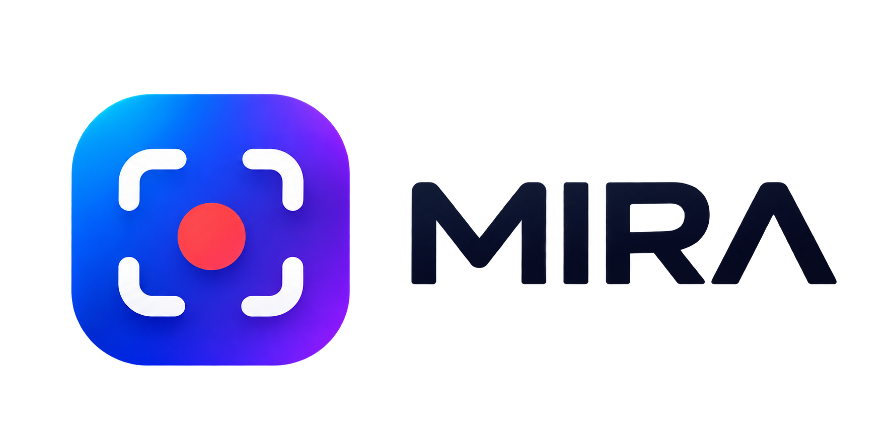
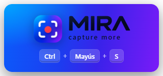
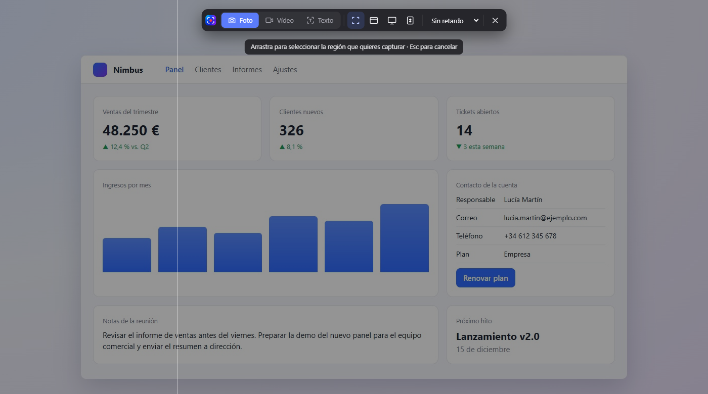
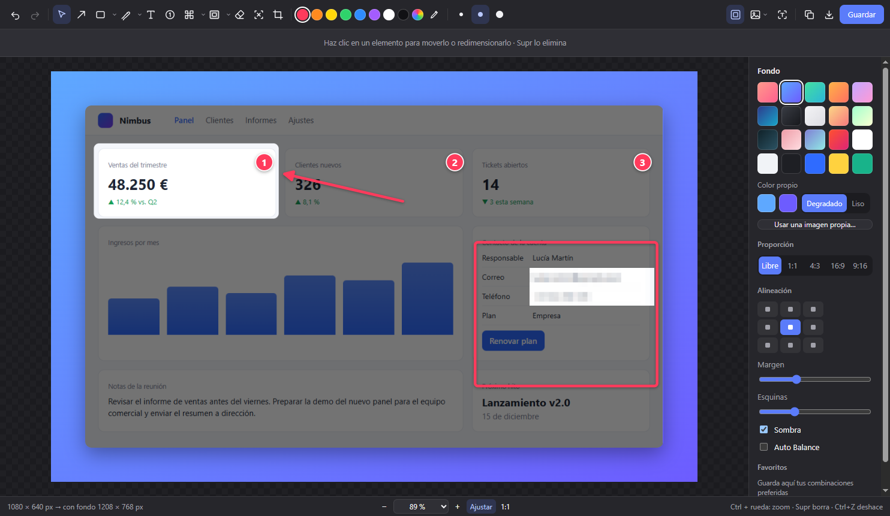
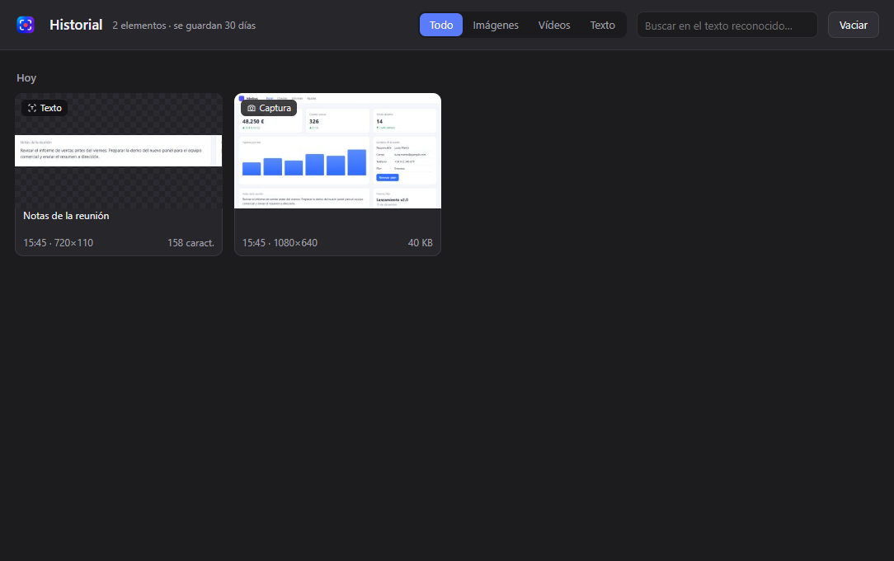
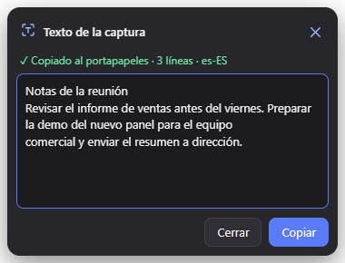
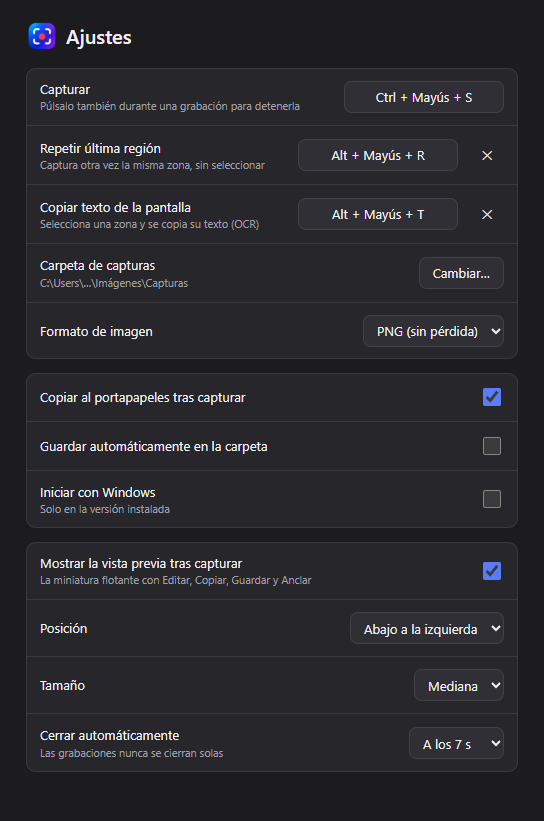

# MIRA – Product Documentation

**MIRA** — *capture more*. App de **screenshots**, **screen recording** y **OCR** para Windows, con editor de anotaciones y
editor de vídeo. Versión 0.1.0 · noviembre de 2026.

## Índice

1. [Overview](#1-overview)
2. [Features](#2-features)
3. [User Guide](#3-user-guide)
4. [Shortcuts](#4-shortcuts)
5. [Settings](#5-settings)
6. [Workflows](#6-workflows)
7. [Troubleshooting](#7-troubleshooting)
8. [Roadmap](#8-roadmap)

## 1. Overview

MIRA captura lo que hay en pantalla —imagen, vídeo o texto— y te deja editarlo y compartirlo en segundos, sin salir del
flujo de trabajo. Vive en la **system tray** de Windows y se abre con un atajo global (`Ctrl + Mayús + S`).

**Para qué sirve**

- Explicar algo con una imagen anotada: flechas, textos, pasos numerados, foco y lupa.
- Grabar un vídeo corto de un proceso, con clics, teclas y webcam, y exportarlo a MP4 o GIF.
- Copiar el texto de cualquier imagen o leer un código QR (**OCR**).
- Ocultar datos sensibles antes de compartir (pixelado, desenfoque seguro y censura automática).
- Capturar páginas o chats enteros con la **scrolling capture**.

**A quién va dirigida:** a quien hace documentación, soporte, formación, diseño o QA, y en general a cualquiera que
comparta capturas a diario.

**Inspiración y principios.** MIRA es una app **original**: toma la idea de elegir **Foto / Vídeo / Texto** de la
Herramienta Recortes de Windows 11 y el estilo de edición de CleanShot X, pero el diseño, el código y los iconos son
propios. Sus principios son: rapidez (todo a un atajo de distancia), interfaz minimalista oscura y privacidad (todo se
procesa en local, también el OCR).

*Aviso de inicio: MIRA queda lista en la bandeja y recuerda el atajo para capturar.*

## 2. Features

MIRA reúne cuatro bloques: captura, editor de imágenes, vídeo y organización (historial, vista previa y anclado).

### 2.1 Captura

| Feature | Qué hace |
| --- | --- |
| **Foto / Vídeo / Texto** | Interruptor en la barra superior del **overlay** para elegir qué capturar |
| **Region** | Arrastra para seleccionar una zona, con lupa de píxeles y medidas |
| **Window** | Resalta la ventana bajo el cursor y la captura con un clic |
| **Fullscreen** | Captura una pantalla; con 2 o 3 monitores eliges cuál o **Todas** |
| **Scrolling capture** | Desplaza la página sola y une las partes; detecta cabeceras fijas y quita la barra de desplazamiento |
| **Last region** | Repite la última zona capturada con un atajo |
| **Delay** | Temporizador de 3, 5 o 10 s antes de capturar |
| **OCR / QR** | Copia el texto de una zona o lee un código QR y ofrece abrir el enlace |

*Overlay de captura: interruptor Foto / Vídeo / Texto, modos (Región, Ventana, Pantalla, Desplazamiento) y retardo.*

### 2.2 Editor de imágenes

| Grupo | Herramientas |
| --- | --- |
| Básicas | Seleccionar, Flecha, Texto, Contador, Goma, Quitar objeto, Recortar |
| Formas | Rectángulo, Elipse y Línea, con borde, relleno o ambos |
| Dibujo | Lápiz con suavizado y **Highlighter** inteligente que se ajusta a la línea de texto |
| Ocultar | Pixelar, Desenfocar (**secure blur**, irreversible) y **auto-censor** de correos, teléfonos, tarjetas, IBAN, DNI/NIE e IP |
| Destacar | **Spotlight** (oscurece el resto) y **Magnifier** (×1,5 / ×2 / ×3) |

Además:

- **Flechas curvables** con tiradores en extremos y centro, 4 estilos (normal, fina, gruesa, doble) y punta hueca o rellena.
- **Texto** con 7 estilos: simple, contorno, sombra, fondo, translúcido, bocadillo y píldora.
- **Color picker** con paleta, valores RGB y **eyedropper** para copiar cualquier color de la pantalla.
- **Background**: 20 fondos o una imagen propia, con proporción, alineación, margen, esquinas, sombra, **Auto Balance** y favoritos.
- **Menú Imagen**: rotar, voltear, redimensionar, censura automática, copiar texto y anclar.
- **Undo / Redo**, zoom con barra de porcentaje y aviso al cerrar si hay cambios sin guardar.

*Editor: Spotlight sobre la cifra clave, flecha, pasos numerados, rectángulo, datos pixelados y panel Background a la derecha.*

### 2.3 Vídeo

- **Screen recording** de una región, ventana o pantalla, con micrófono y audio del sistema.
- **Mostrar clics** y **mostrar teclas** (este último desactivado por defecto para no grabar contraseñas).
- **Webcam** en burbuja, movible y en tres tamaños (S/M/L).
- **Video editor**: recorte de inicio y fin, y exportación a **MP4, GIF o WebM** con resolución, FPS y calidad.

### 2.4 Organización

- **Quick Access preview**: tarjeta flotante tras cada captura con Editar, Copiar, Guardar y Anclar; se apilan hasta 4 y
  se pueden arrastrar a otra app.
- **Pin**: la captura queda flotando encima de todo; rueda = tamaño, `Ctrl` + rueda = opacidad.
- **History**: todo lo capturado, grabado o copiado como texto en los últimos 30 días, con filtros y búsqueda en el texto
  reconocido.

*History: capturas, vídeos y textos de los últimos 30 días, con filtros y búsqueda en el texto reconocido.*

## 3. User Guide

Todo empieza con `Ctrl + Mayús + S` o con un clic en el icono de MIRA en la bandeja.

### 3.1 Hacer una captura (Foto)

1. Pulsa `Ctrl + Mayús + S`. La pantalla se congela y aparece la barra superior.
2. Elige **Foto** y el modo: Región, Ventana, Pantalla o Desplazamiento.
3. Si quieres, activa un retardo de 3, 5 o 10 s.
4. Selecciona la zona (o haz clic en la ventana o pantalla).
5. Aparece la **preview** flotante: la captura ya está copiada al portapapeles si tienes activado «Copiar al
   portapapeles tras capturar».
6. Desde la preview: **Editar**, **Copiar**, **Guardar** o **Anclar**. También puedes arrastrarla a otra app.

Para cancelar en cualquier momento: `Esc` o clic derecho.

### 3.2 Editar una captura

1. En la preview, pulsa **Editar** (o doble clic en una captura anclada).
2. Elige una herramienta en la barra superior o con su tecla (por ejemplo `A` para Flecha).
3. Las opciones de la herramienta salen en la barra contextual de debajo: estilo, borde o relleno, tamaño, etc.
4. Para curvar una flecha, arrastra el punto azul del centro.
5. Para añadir un fondo, abre el panel **Background** y elige un fondo, proporción y margen.
6. Termina con **Guardar** (`Ctrl + S`), **Guardar como** (`Ctrl + Mayús + S`) o **Copiar** (`Ctrl + C`).

Si cierras con cambios sin guardar, MIRA te pregunta si quieres guardarlos.

### 3.3 Grabar un vídeo

1. Abre MIRA y elige **Vídeo** en la barra superior.
2. Activa lo que necesites: micrófono, audio del sistema, clics, teclas o webcam.
3. Selecciona la región, ventana o pantalla. Tras la cuenta atrás empieza la grabación.
4. Usa la barra flotante para pausar o detener.
5. Al terminar, abre la preview con doble clic o **Editar y recortar** para recortar y exportar.

### 3.4 Copiar texto (OCR) o leer un QR

1. Pulsa `Alt + Mayús + T` o elige **Texto** en la barra.
2. Selecciona la zona con texto o con un código QR.
3. El texto se copia al portapapeles y aparece una tarjeta para revisarlo. Si es un enlace, puedes abrirlo.

*Tarjeta de OCR: el texto ya está copiado; se puede corregir antes de volver a copiarlo.*

### 3.5 Captura con desplazamiento

1. Elige **Foto** → **Desplazamiento**.
2. Selecciona la zona que se desplaza (la página o el chat, sin la barra lateral).
3. MIRA baja la página sola y une las partes. Puedes pausar y desplazarte tú con la rueda.
4. Pulsa **Terminar y unir** para abrir el resultado en la preview.

## 4. Shortcuts

Los tres atajos globales funcionan desde cualquier app y se cambian en **Settings**; los del editor son fijos.

### 4.1 Globales

| Acción | Atajo por defecto |
| --- | --- |
| Capturar (y detener una grabación) | `Ctrl + Mayús + S` |
| Repetir última región | `Alt + Mayús + R` |
| Copiar texto de la pantalla (OCR) | `Alt + Mayús + T` |
| Cancelar la captura | `Esc` o clic derecho |
| Recuperar la última preview cerrada | `Ctrl + Z` |

### 4.2 Herramientas del editor

| Tecla | Herramienta | Tecla | Herramienta |
| --- | --- | --- | --- |
| `V` | Seleccionar | `H` | Resaltador |
| `A` | Flecha | `X` | Pixelar |
| `R` | Rectángulo | `B` | Desenfocar |
| `O` | Elipse | `G` | Goma |
| `L` | Línea | `Q` | Quitar objeto |
| `P` | Lápiz | `C` | Recortar |
| `T` | Texto | `F` | Foco |
| `N` | Contador | `M` | Lupa |
| `I` | Cuentagotas | | |

### 4.3 Acciones del editor

| Acción | Atajo |
| --- | --- |
| Deshacer / Rehacer | `Ctrl + Z` / `Ctrl + Y` (o `Ctrl + Mayús + Z`) |
| Guardar / Guardar como | `Ctrl + S` / `Ctrl + Mayús + S` |
| Copiar imagen | `Ctrl + C` |
| Seleccionar todo | `Ctrl + A` |
| Borrar selección | `Supr` o `Retroceso` |
| Zoom | `Ctrl` + rueda, `Ctrl + +` / `Ctrl + -` |
| Ajustar a la ventana / 100 % | `Ctrl + 0` / `Ctrl + 1` |
| Ajustar a 45° o forma proporcional | Mantener `Mayús` al dibujar |
| Aplicar / cancelar recorte | `Intro` / `Esc` |
| Terminar un texto | `Ctrl + Intro` o clic fuera |

### 4.4 Editor de vídeo y capturas ancladas

| Acción | Atajo |
| --- | --- |
| Marcar inicio / fin del recorte | `I` / `O` |
| Tamaño de la captura anclada | Rueda |
| Opacidad de la captura anclada | `Ctrl` + rueda |
| Editar la captura anclada | Doble clic |

## 5. Settings

Los ajustes se abren desde el menú de la bandeja (**Ajustes…**), se aplican al momento y se guardan en
`%APPDATA%\Mira\settings.json`.

| Ajuste | Opciones | Por defecto |
| --- | --- | --- |
| Atajo **Capturar** | Cualquier combinación con `Ctrl` o `Alt`, F1–F12 o Impr Pant | `Ctrl + Mayús + S` |
| Atajo **Repetir última región** | Igual que el anterior, o sin atajo | `Alt + Mayús + R` |
| Atajo **Copiar texto de la pantalla** | Igual que el anterior, o sin atajo | `Alt + Mayús + T` |
| Carpeta de capturas | Cualquier carpeta | `Imágenes\Capturas` |
| Formato de imagen | PNG (sin pérdida) o JPG (más ligero) | PNG |
| Copiar al portapapeles tras capturar | Sí / No | Sí |
| Guardar automáticamente en la carpeta | Sí / No | No |
| Iniciar con Windows | Sí / No (solo en la versión instalada) | No |
| Mostrar la **preview** tras capturar | Sí / No | Sí |
| Posición de la preview | Abajo a la izquierda / a la derecha | Izquierda |
| Tamaño de la preview | Pequeña, Mediana, Grande | Mediana |
| Cerrar la preview automáticamente | Nunca, 5, 7, 10 o 20 s (las grabaciones no se cierran solas) | 7 s |

Si otra aplicación ya usa un atajo, MIRA lo avisa en esta pantalla. Las opciones de cada captura (Foto/Vídeo, modo,
micrófono, clics, webcam…) se recuerdan de una vez a la siguiente.

## 6. Workflows

Cinco recorridos cubren casi todo el uso diario; cada uno se hace en menos de un minuto.

**Explicar un error a un compañero (bug report)**

1. `Ctrl + Mayús + S` → Región sobre el error.
2. **Editar** → Flecha (`A`) hacia el fallo y Contador (`N`) para numerar los pasos.
3. Foco (`F`) sobre la zona clave para oscurecer el resto.
4. `Ctrl + C` y pegar en el chat o en la incidencia.

**Compartir una captura sin datos sensibles**

1. Captura la ventana con el modo Ventana.
2. Menú **Imagen** → **Censura automática**: oculta correos, teléfonos, tarjetas e IBAN.
3. Revisa y completa con Pixelar (`X`) o Desenfocar (`B`).
4. Guarda con `Ctrl + S`.

**Tutorial en vídeo o GIF**

1. `Ctrl + Mayús + S` → **Vídeo**, con clics y webcam activados.
2. Graba el proceso y detén con el mismo atajo.
3. **Editar y recortar**: quita el principio y el final con `I` / `O`.
4. Exporta a **GIF** para un chat o a **MP4** para una presentación.

**Copiar texto de una imagen, PDF o vídeo**

1. `Alt + Mayús + T` y selecciona el texto.
2. Ya está en el portapapeles; revísalo en la tarjeta si hace falta.

**Imagen de marketing o documentación**

1. Captura la ventana de la app.
2. Panel **Background**: elige un fondo, proporción 16:9, margen y sombra; activa **Auto Balance**.
3. Guarda el estilo como favorito para reutilizarlo en las siguientes capturas.
4. Guarda en PNG.

## 7. Troubleshooting

La mayoría de problemas vienen de atajos ocupados por otra app o de permisos de Windows.

| Problema | Causa probable | Solución |
| --- | --- | --- |
| El atajo no hace nada | Otra app (OneDrive, Teams, Recortes…) usa la misma combinación | Settings avisa del atajo ocupado: elige otro. Mientras tanto, captura desde el icono de la bandeja |
| No veo MIRA en la bandeja | Windows la oculta en el menú de iconos ocultos (˄) | Arrastra el icono a la barra de tareas para que quede siempre visible |
| Windows avisa al instalar (SmartScreen) | El instalador no está firmado digitalmente | **Más información** → **Ejecutar de todas formas** |
| La grabación no tiene sonido | Micrófono o audio del sistema desactivados, o sin permiso de micrófono | Actívalos en la barra de Vídeo y revisa Configuración de Windows → Privacidad → Micrófono |
| La webcam no aparece | Otra app la está usando o falta el permiso de cámara | Cierra la otra app y revisa Privacidad → Cámara |
| El OCR se salta texto | Letra muy pequeña, baja resolución o líneas muy repetitivas (p. ej. `1111 1111`) | Amplía el zoom antes de capturar o selecciona menos texto |
| El OCR no reconoce el idioma | Falta el paquete de idioma de Windows | Configuración → Hora e idioma → Idioma: añade el idioma con «Reconocimiento óptico de caracteres» |
| La captura con desplazamiento sale cortada o repetida | La zona incluye partes fijas o la página carga contenido al bajar | Selecciona solo la zona que se desplaza; pausa el modo automático y baja tú con la rueda |
| No encuentro una captura | No estaba activado «Guardar automáticamente» | Abre **Historial de capturas** desde la bandeja: guarda los últimos 30 días |
| Cerré la preview sin querer | — | `Ctrl + Z` o «Recuperar» desde la bandeja |

## 8. Roadmap

Propuesta de próximas funcionalidades, ordenadas por prioridad; ninguna tiene fecha comprometida todavía.

| Funcionalidad | Qué aporta | Prioridad |
| --- | --- | --- |
| **Auto-update** e instalador firmado | Actualizaciones automáticas y sin aviso de SmartScreen | Alta |
| **Cloud sharing** | Subir la captura y copiar un enlace para compartir | Alta |
| **Traducción del OCR** | Copiar el texto reconocido ya traducido | Media |
| Anotar sobre vídeo | Flechas, textos y zoom dentro del editor de vídeo | Media |
| **Plantillas de fondo por equipo** | Fondos y estilos compartidos para documentación coherente | Media |
| Grabación con **zoom automático** | Acercar la imagen donde se hace clic | Media |
| Interfaz en inglés | Idioma de la app seleccionable (español / inglés) | Baja |
| Tema claro | Alternativa al tema oscuro actual | Baja |
| Versión para macOS | Misma app en Mac | Baja |
